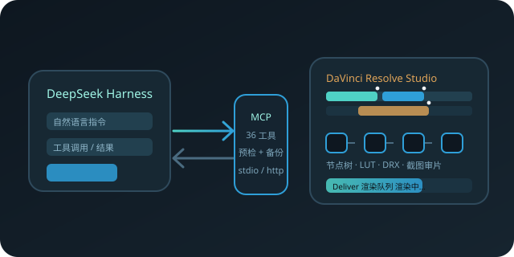

# DaVinci Resolve 青青桥接

**让青青住进你的dsh** —— 把 DeepSeek Harness 与 DaVinci Resolve Studio（v19 / v20 / v21+）连成一条自然语言驱动的剪辑、调色、合成与交付流水线。

## 这个插件做什么

它是一个 MCP 桥接包：安装后 DSH 会从 stdio 拉起本地 Python MCP 服务
（`python -m dsh_davinci_qing.server`），把 **36 个 `qing_*` 工具**注册成模型可直接调用的能力，覆盖六大模块：

| 模块 | 工具前缀 | 能力 |
| --- | --- | --- |
| 环境与工程 | `qing_resolve_*` `qing_project_*` `qing_open_page` | 跨平台定位脚本 API 与 fusionscript、Studio 版本校验、外部脚本开关推断、工程/时间线总览、切页 |
| 媒体池与归档 | `qing_media_*` | 递归导入、按机位/日期/类型/关键词自动分箱、批量元数据、按标记生成子剪辑、素材检索 |
| 时间线编辑 | `qing_timeline_*` | 新建时间线（分辨率/帧率）、追加与精准插入、片段变换与裁切批量修改、彩色标记、SRT 字幕、轨道锁定、批量删除 |
| Color 调色 | `qing_color_*` | 节点树解析、`SetLUT` 挂载、节点启用/旁通、跨片段 `CopyGrades`、`.drx` PowerGrade 批量应用、导出当前帧给多模态审片 |
| Fusion 合成 | `qing_fusion_*` | 取 `FusionComp`、添加 `TextPlus`/`Transform`/`ColorCorrector` 等节点、改文本与数值 |
| Deliver 交付 | `qing_deliver_*` | 渲染预设列表、加载预设、输出目录与文件名、`AddRenderJob`、队列状态、启动与停止 |

## 怎么开始

1. **装依赖**（与插件目录同级）：

   ```powershell
   cd F:\dsh-davinci-qing
   python -m pip install -r requirements.txt
   python check_env.py
   ```

2. **在 Resolve 里打开外部脚本**：`首选项 → 系统 → 常规 → External scripting using` 设为 **Local**，然后**重启 Resolve**（改完不重启不生效）。同时要打开一个工程并建好时间线。

3. **让 DSH 连上**：安装本 bundle 后，工具会以 `mcp__davinci__qing_*` 出现在模型工具列表里。第一次对话先说一句"帮我自检 Resolve 环境"，它会调 `qing_resolve_health` 并把不满足的条件逐条列出来。

4. **只想先看能不能用**：`python check_env.py --simulate` 会用内置模拟器跑通全链路，不依赖真实 Resolve。

## 安全约定（重要）

- **检查点**：任何批量删改时间线、覆盖调色、批量改素材属性的工具，执行前都会
  `SaveProject()` + `DuplicateTimeline("[Backup_HHMMSS]_原时间线名")`。备份时间线建不出来时**默认拒绝执行**；确实不需要可用 `allow_without_backup=true` 显式承担风险。
- **Pre-flight**：轨道索引越界、轨道被锁定、`.cube`/`.drx` 不存在或扩展名不对、帧号越界、节点序号越界，都会在调用 Resolve 之前一次性拦下，并逐条给出修正建议。预检失败不会产生任何写入。
- **审计日志**：每次检查点与破坏性写入都追加到 `~/.dsh-davinci-qing/audit.jsonl`（可用 `QING_STATE_DIR` 改位置）。
- **不做的事**：不改 `Preferences`、不替你点界面、不在未要求时启动渲染。

## 已知限制

- 需要 **Studio 版**：免费版没有外部脚本接口，`qing_resolve_health` 会直接报 `resolve_free_version`。
- **节点启用/旁通**与 **`.drx` 应用**依赖 v19+ 的 `TimelineItem.GetNodeGraph()`；更早版本会返回 `unsupported` 并给出替代做法。
- **SRT 字幕**优先走 `Timeline.ImportIntoTimeline`（v18.5+）；不支持时退化为 Fusion 文本片段（放在视频轨上，不是可编辑字幕条目），结果里会明确标出 `method`。
- Resolve 没有"撤销栈"可供脚本回滚，所以回滚手段只有备份时间线。
- `ExportCurrentFrameAsStill` 需要界面停在调色页且有播放头所在片段，否则返回空文件；工具会自动切页仍失败时会给出排查提示。

## 目录

- `dsh_davinci_qing/` —— MCP 服务端与各功能模块（`server.py`、`resolve_connector.py`、`safety_guard.py`、`media_pool_tools.py`、`timeline_tools.py`、`color_tools.py`、`fusion_deliver_tools.py`、`fake_resolve.py`）
- `docs/TOOLS.md` —— 36 个工具的参数表与副作用说明（由 `export_schema.py` 生成）
- `docs/tool-schemas.json` —— 同源的 JSON Schema
- `skills/davinci-qing/SKILL.md` —— DSH 技能声明（触发时机与工作流）
- `check_env.py` —— 一键自检；`export_schema.py` —— 重新生成工具文档；`tests/` —— 模拟器端到端测试
