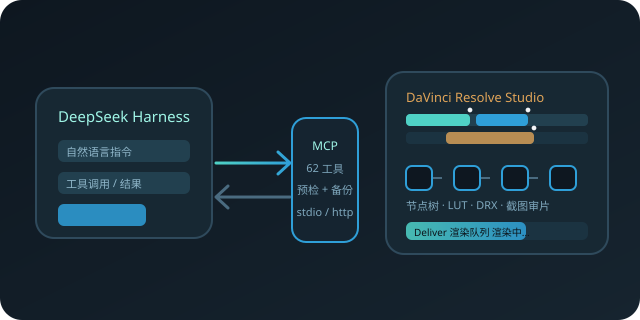

# 快乐青青

**让青青住进你的dsh** —— 把 DeepSeek Harness 与 DaVinci Resolve Studio（v19 / v20 / v21+）连成一条自然语言驱动的剪辑、调色、合成与交付流水线。

## 这个插件做什么

它是一个 **Cordis 插件壳 + 本地 Python 运行时**：DSH 加载 `dist/index.js`，插件从 stdio 拉起
`lib/resolve_bridge.py --serve` 常驻进程，把 **62 个 `qing_*` 工具**注册成模型可直接调用的能力，
覆盖七大模块：

| 模块 | 工具前缀 | 能力 |
| --- | --- | --- |
| 环境与工程 | `qing_resolve_*` `qing_project_*` `qing_open_page` | 跨平台定位脚本 API 与 fusionscript、Studio 版本校验、外部脚本开关推断、工程/时间线总览、切页 |
| 媒体池与归档 | `qing_media_*` | 递归导入、按机位/日期/类型/关键词自动分箱、批量元数据、**导出元数据 CSV 取真实键名**、按标记生成子剪辑、素材检索 |
| 时间线编辑 | `qing_timeline_*` | 新建时间线（分辨率/帧率）、追加与精准插入、片段变换与裁切批量修改、彩色标记的增读删、入出点、SRT 字幕、轨道锁定、批量删除、**AAF/XML/EDL/OTIO 导出** |
| Color 调色 | `qing_color_*` | 节点树解析、节点**标签与颜色**寻址、`SetLUT` 挂载、节点启用/旁通、跨片段 `CopyGrades`、`.drx` PowerGrade 批量应用、导出当前帧 + 像素统计给多模态审片 |
| Fusion 合成 | `qing_fusion_*` | 取 `FusionComp`、添加 `TextPlus`/`Transform`/`ColorCorrector` 等节点、改文本与数值，并明确回报**是否已连到 MediaOut** |
| Deliver 交付 | `qing_deliver_*` | 格式/编码/分辨率探测、渲染预设列表与加载、输出目录与文件名、**全量 RenderSettings 直写**、防覆盖策略、`AddRenderJob`、队列状态、启动与停止 |
| 官方 MCP 层 | `qing_official_*` | **完整继承官方 Resolve MCP 的 18 项能力**：读调色实际参数与 ASC CDL、渲染单帧（支持 ROI 局部放大）与缩略图网格、实时 API 存根检索与开发者文档、沙箱/不限权脚本执行、LUT/DCTL 读写与按函数生成 .cube、Extras 下载管理器、启动与状态 |

官方 MCP 层是与脚本 API **并行**的另一条通道（需要 Resolve Studio 21.1+）。
它能提供脚本 API 结构上拿不到的东西——例如「节点里 Blur 半径被改成了 12.5」
（脚本只能读到「节点里有 Blur」）。不可用时该层工具统一报 `official_mcp_unavailable`，
其余 43 个工具照常工作。

## 怎么开始

1. **装依赖**（与插件目录同级）：

   ```powershell
   cd F:\dsh-davinci-qing
   python -m pip install -r requirements.txt
   python check_env.py
   ```

2. **在 Resolve 里打开外部脚本**：`首选项 → 系统 → 常规 → External scripting using` 设为 **Local**，然后**重启 Resolve**（改完不重启不生效）。同时要打开一个工程并建好时间线。

3. **让 DSH 连上**：安装本插件后，工具会以 `mcp__davinci__qing_*` 出现在模型工具列表里。第一次对话先说一句"帮我自检 Resolve 环境"，它会调 `qing_resolve_health` 并把不满足的条件逐条列出来。

4. **只想先看能不能用**：`python check_env.py --simulate` 会用内置模拟器跑通全链路，不依赖真实 Resolve。

## 安全约定（重要）

- **检查点**：任何批量删改时间线、覆盖调色、批量改素材属性的工具，执行前都会
  `SaveProject()` + `DuplicateTimeline("[Backup_HHMMSS]_原时间线名")`。备份时间线建不出来时**默认拒绝执行**；确实不需要可用 `allow_without_backup=true` 显式承担风险。
- **Pre-flight**：轨道索引越界、轨道被锁定、`.cube`/`.drx` 不存在或扩展名不对、帧号越界、节点序号/标签不存在、目标目录已有同名渲染结果，都会在调用 Resolve 之前一次性拦下，并逐条给出修正建议。预检失败不会产生任何写入。
- **回读覆盖前的值**：挂 LUT 会回读被覆盖的原 LUT（`replaced_luts`），切换节点启用状态会回读 `previous_enabled`——覆盖类操作永远告诉你代价。
- **审计日志**：每次检查点与破坏性写入都追加到 `~/.dsh-davinci-qing/audit.jsonl`（可用 `QING_STATE_DIR` 改位置）。
- **不做的事**：不改 `Preferences`、不替你点界面、不在未要求时启动渲染。

## 已知限制

- 需要 **Studio 版**：免费版没有外部脚本接口，`qing_resolve_health` 会直接报 `resolve_free_version`。
- **节点序号不是稳定 ID**：序号按创建顺序分配，删掉任一节点后整棵树重编号。长期指认请用
  `qing_color_label_nodes` 打标签，再以 `node_label` 寻址。
- **覆盖类接口没有"只改一部分"**：`SetLUT` 覆盖已有 LUT、`CopyGrades` 整体覆盖目标 grade 且不携带关键帧、套 `.drx` 只作用于当前 Node Editor 模式的 grade。
- **脚本 API 没有限定器/窗口/跟踪接口**：`qing_color_inspect_nodes` 只能通过 `GetToolsInNode` 间接告诉你节点里有没有 HSL Qualifier / Power Window。
- **Fusion 连线无法用脚本完成**：`AddTool` 新建的节点默认未连线，未连线不参与输出；工具会在返回值里标明 `connected_to_output`。
- **SRT 字幕**优先走 `Timeline.ImportIntoTimeline`（v18.5+）；不支持时退化为 Fusion 文本片段（放在视频轨上，不是可编辑字幕条目），结果里会明确标出 `method`。
- **截图不是示波器**：`qing_color_grab_frame` 返回的是 8 位显示参考图，附带的像素统计只用于方向性判断，不能当 IRE / 0–1023 读数。
- **官方 MCP 层是完整继承，不是可选项**：`qing_official_*` 共 19 个工具，覆盖官方
  Resolve MCP 的全部 18 项能力（`qing_official_tools` 是能力清单）。它需要 Resolve
  Studio 21.1+ 随附的 `ResolveMCP.exe`；不可用时（版本不够、非 Studio、或正在模拟器
  模式）该层统一报 `official_mcp_unavailable`，其余 43 个工具不受影响。
- **官方层里两个脚本工具不建检查点**：`qing_official_run_script`（沙箱，屏蔽文件/网络/
  子进程）与 `qing_official_run_script_unsafe`（完全权限）都能改工程，且**绕过四重护栏**。
  调用前必须让用户明确知情；需要备份时先用带检查点的工具。
- **官方 MCP 在模拟器模式下完全禁用**：`QING_DAVINCI_FAKE=1` 承诺不碰真实 Resolve，
  而官方 MCP 会直接跟真实实例说话。`tests/audit_features.py` 第 6 项守着这条红线。
- Resolve 没有"撤销栈"可供脚本回滚，所以回滚手段只有备份时间线。
- `ExportCurrentFrameAsStill` 需要界面停在调色页且有播放头所在片段，否则返回空文件；工具会自动切页仍失败时会给出排查提示。

## 目录

- `dist/` 与 `src/` —— Cordis 插件壳（`src/index.ts` 注册工具、托管 Python 子进程）
- `lib/resolve_bridge.py` —— 常驻 JSON-RPC 桥；`lib/server.py` —— 独立 MCP 服务端
- `lib/modules/` —— 业务模块（`resolve_connector.py`、`safety_guard.py`、`media_pool_tools.py`、`timeline_tools.py`、`color_tools.py`、`fusion_deliver_tools.py`、`official_mcp.py`、`official_tools.py`、`fake_resolve.py` 等）
- `docs/TOOLS.md` —— 62 个工具的参数表与副作用说明（由 `export_schema.py` 生成）
- `docs/tool-schemas.json` —— 同源的 JSON Schema
- `docs/manual-notes/` —— 按《DaVinci Resolve 21.1 Reference Manual》整理的知识笔记（带页码）
- `SKILL.md` —— DSH 技能声明（触发时机与工作流）
- `check_env.py` —— 一键自检；`export_schema.py` —— 重新生成工具文档；`tests/` —— 模拟器端到端测试
